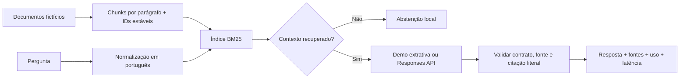

<div align="center">

# Evidence RAG

Um assistente de suporte que busca documentos em português e confere as fontes citadas na resposta.

RAG em português · BM25 · Structured Outputs · Node.js 24 · Zero dependências

[](https://github.com/MatheusSBCastro/evidence-rag/actions/workflows/ci.yml)

[Começar](#executar-em-um-minuto) · [Arquitetura](#como-funciona) · [Avaliações](#avaliações) · [Limites](#limites-conhecidos)

</div>

## O problema

Ao responder uma dúvida de suporte, o assistente precisa encontrar o trecho certo e citar a fonte. O Evidence RAG faz essa busca em uma base fictícia, retorna uma resposta estruturada e confere as citações antes de exibi-la.

Criei este laboratório para estudar sistemas com LLMs, com ajuda de IA no desenvolvimento inicial. O código inclui os testes e as decisões de implementação; as limitações estão descritas abaixo.

## Executar em um minuto

Requer Node.js 24 ou superior. Não precisa instalar pacotes, criar conta nem configurar chave para a demonstração.

```sh
git clone https://github.com/MatheusSBCastro/evidence-rag.git
cd evidence-rag
npm run demo
npm run ask -- "Como validar a assinatura dos webhooks?"
npm test
npm run eval
```

A demonstração copia o trecho mais relevante e identifica esse modo no JSON como `extractive-demo`. Não há chamada nem simulação de LLM nessa execução. Se nenhum trecho tiver pelo menos dois termos da pergunta, o sistema se abstém de responder.

Exemplo resumido:

```json
{
  "mode": "extractive-demo",
  "answer": {
    "status": "supported",
    "claims": [{
      "text": "Os webhooks enviam eventos por HTTP POST...",
      "sourceId": "integration:<hash-do-trecho>",
      "quote": "Os webhooks enviam eventos por HTTP POST..."
    }]
  }
}
```

O exemplo acima foi abreviado; a execução retorna o trecho completo, fontes, pontuação e latência.

## Como funciona



| Decisão | Por quê |
| --- | --- |
| BM25 implementado localmente | Permite reproduzir a busca e entender os erros antes de experimentar embeddings. |
| Um parágrafo por chunk, ID com SHA-256 | Fontes permanecem estáveis ao reordenar documentos. |
| Top 3 e pelo menos dois termos correspondentes | Reduz recuperação por coincidência de uma única palavra; é uma heurística ajustável, sem calibração estatística. |
| JSON Schema e validação local | O contrato é aplicado mesmo se o provedor retornar uma resposta inadequada. |
| IDs e citações validados contra o contexto | Rejeita fontes inventadas e citações que não existem nos trechos recuperados. |
| Geração opcional e injetável | Os testes substituem o provedor por respostas controladas, sem rede ou cobrança. |

## Usar um modelo real

O adapter usa a [Responses API](https://developers.openai.com/api/reference/resources/responses/methods/create) com [Structured Outputs](https://developers.openai.com/api/docs/guides/structured-outputs), `store: false`, timeout de 20 segundos e limite de saída. Escolha um modelo da sua conta que aceite essa configuração.

No PowerShell, configure as variáveis **somente no seu terminal**:

```powershell
$env:OPENAI_API_KEY = 'SUA_CHAVE'
$env:OPENAI_MODEL = 'MODELO_COMPATIVEL_DA_SUA_CONTA'
npm.cmd run ask -- --live "Como recuperar a senha?"
```

No Bash, use `export OPENAI_API_KEY=...` e `export OPENAI_MODEL=...`. `.env.example` documenta as variáveis; arquivos `.env` não são carregados automaticamente. Nunca coloque chaves no código.

O modo `--live` envia a pergunta e os trechos recuperados à OpenAI e pode gerar cobrança. A resposta informa o uso de tokens reportado pelo provedor. O projeto não estima preços. **A integração real não foi executada nesta versão**; o contrato HTTP e os fluxos de erro foram testados com respostas controladas.

## Avaliações

O comando `npm run eval` regenera [`evals/report.json`](evals/report.json). O conjunto tem **20 perguntas sintéticas**: 16 com documento esperado e 4 fora de domínio, sobre 8 documentos/16 chunks.

| Métrica offline | Resultado inicial |
| --- | --- |
| Recall@3 por documento | 1,00 |
| MRR@3 por documento | 1,00 |
| Abstenção nas 4 perguntas fora de domínio | 1,00 |

As perguntas foram escritas junto da implementação e usam vocabulário próximo ao da base. O resultado serve como uma verificação inicial, com dados sintéticos. Uma avaliação independente ainda precisa medir generalização, precisão do trecho recuperado e qualidade da geração. Nenhum dado real de usuário entrou neste conjunto.

Os 15 testes automatizados verificam recuperação, IDs estáveis, limites de entrada, fontes forjadas, citações alteradas, contrato, erros HTTP, recusas, JSON inválido, respostas incompletas e timeout. O teste que verifica a separação entre instruções e dados **não comprova resistência a prompt injection de um modelo real**.

## Limites conhecidos

- Uma citação existente não prova que a afirmação é semanticamente sustentada. O validador verifica origem e integridade literal; revisão de entailment é trabalho futuro.
- Correspondência lexical não entende sinônimos, negações nem perguntas sem resposta que compartilham o vocabulário da base. O modo extrativo pode recuperar um trecho relacionado sem responder à dúvida.
- As fontes são fictícias e locais; não há crawler, ingestão de PDF, autenticação, índice vetorial, reranking ou serviço de produção.
- Prompt injection é tratado no contrato de instruções e pela ausência de ferramentas de ação, mas não há garantia de neutralização de instruções maliciosas.
- A latência de demonstração não representa a latência de um provedor LLM. Geração, custo e fidelidade com modelo real ainda precisam de avaliação.

## Próximos experimentos

1. Conjunto de avaliação independente, com paráfrases, negativas difíceis e perguntas sem resposta dentro do domínio.
2. Comparar BM25 com embeddings e recuperação híbrida sob o mesmo protocolo.
3. Avaliar fidelidade por afirmação e resposta completa com modelo real; registrar configuração, tokens e latência.

## Estrutura

```text
src/rag.mjs          # índice, BM25, contrato e adapter OpenAI
src/cli.mjs          # interface de linha de comando
data/knowledge.json # base fictícia versionada
evals/              # perguntas e relatório reproduzível
scripts/evaluate.mjs
tests/rag.test.mjs
.github/workflows/ci.yml
```

Licença MIT. Veja [LICENSE](LICENSE).
